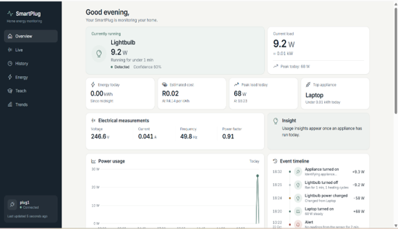
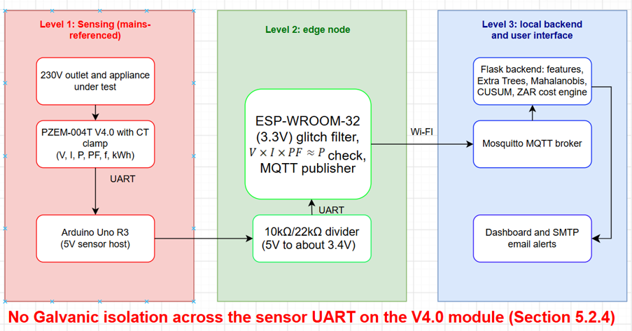
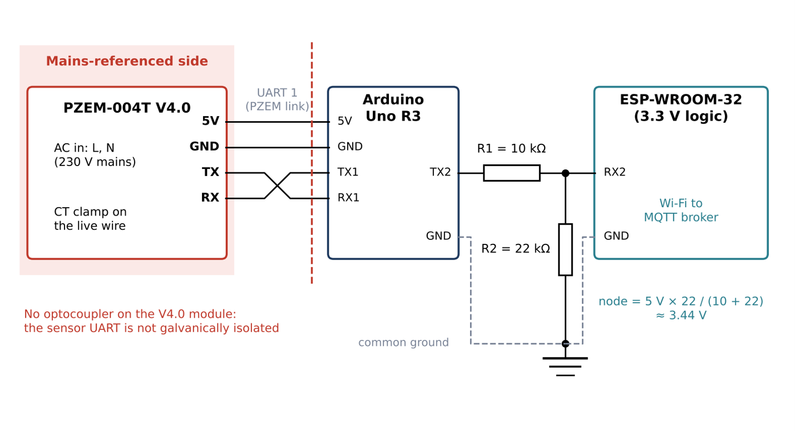
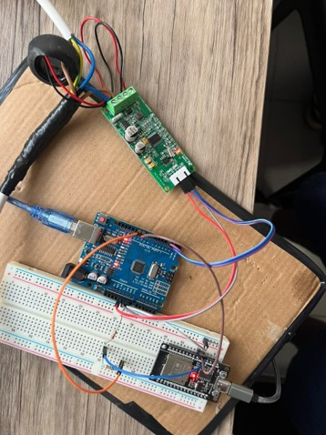
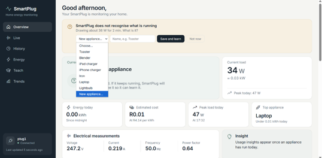
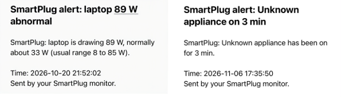

# NILM SmartPlug — IoT-Based Device Identification with Smart Plugs

A low-cost, fully local smart plug that measures the electrical signature of whatever is plugged into it, **names the appliance**, and shows its **running cost in rand (ZAR)**. No cloud services; everything runs on your own network.

> Final-year project (DES371S, Industrial Computing Design Project 3), BEng Tech Computer Engineering, Cape Peninsula University of Technology. Author: Khuphuka Thabo Bosvark. Supervisor: Dr Angus Brandt.



---

##  Safety warning — read first

This is a **supervised bench prototype**. The PZEM-004T **V4.0** module has **no optocouplers**, so the sensor UART is **not galvanically isolated** from the 230 V mains. The Uno, the ESP32 and anything connected to their USB ports can be at mains potential once AC is connected.

- Do **not** hand this to a consumer or leave it running unattended.
- Wire with the power **off**, use an insulated test fixture, and touch nothing while mains is on.
- The fix is a digital isolator on the UART line, or a sensor module with isolation built in (see [Future work](#future-work)).

You build and run this at your own risk.

---

## The problem

A household bill is a single number. It doesn't say which appliance used what, and standby loads waste money unnoticed. Ordinary smart plugs show watts and kWh but can't tell which appliance is connected. Whole-house NILM systems can, but need expensive high-rate sensors at the electricity entry point.

This project sits in between: a sensor at **one outlet** plus software that recognises the appliance from its signature. It is *NILM-inspired*, not true NILM.

## What it does

- Measures voltage, current, power, power factor, frequency and energy (PZEM-004T V4.0 + CT clamp)
- Identifies the appliance with an **Extra Trees** classifier on a 5-reading rolling window (12 features)
- Flags **unknown appliances** with **Mahalanobis distance**, and lets the user name them on the **Teach SmartPlug** page (active learning, model retrains)
- Detects **ON/OFF events** with **CUSUM** and logs the change in watts and runtime
- Converts energy to **cost at R4.14/kWh** (City of Cape Town Domestic Block 1, incl. VAT; energy charge only)
- Sends **email alerts** (SMTP) for an out-of-range load, an unknown appliance running too long, or a sensor that goes silent for 2 minutes
- Validates every reading on the ESP32 (`V × I × PF ≈ P`) before publishing

## Results

| Criterion | Target | Result | Status |
|---|---|---|---|
| Classification quality | ≥ 90% macro F1 | **94.2% macro F1** (99.2% accuracy), stratified k-fold CV | (yes) |
| Inference time | < 1.0 s | **0.121 s** | (yes) |
| Responsiveness | Events visible within 15 s | 5–15 s | (yes) |
| Build cost | < R1500 | **R680** out of pocket (R1444 total project value) | (yes) |
| Alerts | Email on abnormal conditions | Abnormal-load, unknown-device and sensor-lost alerts | (yes) |
| **Galvanic isolation** | Mains side isolated from logic | V4.0 has no optocouplers | (no) **Not met** |

Tested on seven loads: laptop charger, iPad charger, iPhone charger, lightbulb, iron, blender and toaster. See [Limitations](#limitations) for what these numbers do and don't show.

## Architecture

```
230 V outlet ─► appliance ─ CT clamp ─► PZEM-004T V4.0      (mains-referenced)
                                              │ UART 9600, 5 V
                                       Arduino Uno R3        (5 V sensor host)
                                              │ UART through 10 kΩ / 22 kΩ divider (5 V → ~3.4 V)
                                       ESP32-WROOM-32        (3.3 V, glitch filter, V×I×PF≈P check)
                                              │ Wi-Fi · MQTT (JSON)
                                       Mosquitto broker      (laptop)
                                              │
                                       Flask backend
         5-reading window → 12 features → Mahalanobis (known?) → Extra Trees (which?) → CUSUM (events) → cost
                                              │
                                  Web dashboard · SMTP email alerts
```



**Why two microcontrollers?** The ESP32's 5 V pin sat at about 4.3 V on USB power and starved the PZEM, so an Arduino Uno became the 5 V sensor host. The price: a second program, a second serial link, and the level shifter below.

## Hardware

**Parts:** PZEM-004T V4.0 with CT clamp, Arduino Uno R3, ESP-WROOM-32, 10 kΩ and 22 kΩ resistors, a test fixture, and household loads.

| From | To | Note |
|---|---|---|
| PZEM 5V / GND | Uno 5V / GND | |
| PZEM TX / RX | Uno D2 / D3 | SoftwareSerial via `PZEM004Tv30` |
| Uno D11 (TX) | 10 kΩ → node → ESP32 GPIO16 (RX2) | Node = 22 kΩ to GND |
| Uno GND | ESP32 GND | Common ground |

Divider output: `5 V × 22 / (10 + 22) ≈ 3.44 V`, with about 0.16 mA through the divider.




## Software

| File | Role |
|---|---|
| `backend/webapp.py` | Flask server, MQTT ingestion, dashboard API, alerts hook |
| `backend/features.py` | Rolling window → 12 features (shared by training and live serving) |
| `backend/train_model.py` | Trains and cross-validates the Extra Trees model |
| `backend/openset.py` | Mahalanobis unknown-appliance detection |
| `backend/events.py` | CUSUM ON/OFF event detection |
| `backend/alerts.py` | SMTP alerts |
| `backend/analytics.py` | Energy and cost calculations |
| `backend/anomaly.py` | Learned normal range per appliance |
| `backend/store.py` | SQLite storage |
| `backend/collect_data.py` | Logs labelled readings to CSV |
| `backend/demo_openset.py` | Demo of the unknown-appliance check |
| `backend/tests.py` | Tests |
| `backend/static/dashboard.html` | Web dashboard |
| `firmware/ArduinoPZEM/` | Uno sketch: polls the PZEM, forwards readings |
| `firmware/ESPARDUINO/` | ESP32 sketch: sanity check, glitch filter, MQTT publish |

**MQTT:** the ESP32 publishes JSON to `nilm/plug1/reading` about every 7 s (`device_id`, `V`, `I`, `W`, `PF`, `Hz`, `kWh`).

**Features (12):** latest V, I, W, PF; mean, std, min, max and range of power; mean and std of PF; delta W.

## Getting started

### Prerequisites
Python 3.10+, [Mosquitto](https://mosquitto.org/) MQTT broker, Arduino IDE (libraries: `PZEM004Tv30`, `PubSubClient`), and the hardware above.

### 1. Backend
```powershell
git clone https://github.com/thabobosvark/NILM-SmartPlug.git
cd NILM-SmartPlug
python -m venv .venv
.\.venv\Scripts\Activate.ps1
pip install -r requirements.txt
cd backend
Copy-Item ..\.env.example .env      # then fill in your own values
```
Never commit `.env`. It holds your SMTP app password, MQTT and dashboard credentials.

### 2. Train the model
Collect labelled data (one appliance at a time), then train:
```powershell
python collect_data.py
python train_model.py
```
`data/sample_readings.csv` shows the expected CSV format.

### 3. Firmware
Open each sketch in `firmware/`, replace the Wi-Fi and broker placeholders, then flash the Uno and the ESP32. Use the ESP32's **laptop LAN IP** as the broker address.

### 4. Run
```powershell
python webapp.py
```
Open `http://localhost:<PORT>` in your browser (the port is set in `webapp.py`).

## Dashboard

Overview · Live · History · Energy · Teach · Trends




## Limitations

- Breadboard prototype, **not isolated from the mains**
- Dataset collected by one person on one bench with seven appliances, so results may not carry over to other brands or models
- Macro F1 (94.2%) is below accuracy (99.2%), so at least one smaller class is recognised less well. **Per-class results were not recorded.**
- Windowed classification lags after a quick appliance swap (the window still holds the previous load's readings)
- Readings were checked against appliance rated loads. A calibrated reference meter was used only once, early on.
- One appliance per plug; no multi-appliance disaggregation
- The campus network blocked MQTT, so testing used a mobile hotspot

## Future work

- Isolation on the sensor UART (digital isolator IC) or a sensor module with built-in isolation
- Per-class confusion matrix and comparison against a calibrated meter
- Reset the window on a CUSUM step event, and add a confidence cut-off for "unknown"
- PCB and insulated enclosure
- Concurrent multi-appliance disaggregation; local caching for network dropouts

## Experimental extras

`experimental/` holds side experiments that are **not part of the evaluated system**: an autoencoder anomaly model, drift monitoring and an int8 edge-model export. They need extra dependencies (e.g. TensorFlow).

## Budget

R680 out of pocket against a R1500 limit. The campus supplied the ESP32 and Arduino Uno, and a spare PZEM-004T was kept as a backup.

## Key references

Mpawenimana et al. (2018) moving-average preparation · Jitket (2022) smart-plug feature comparison · Geurts, Ernst & Wehenkel (2006) Extra Trees · Qu et al. (2013) CUSUM · OASIS MQTT v5.0